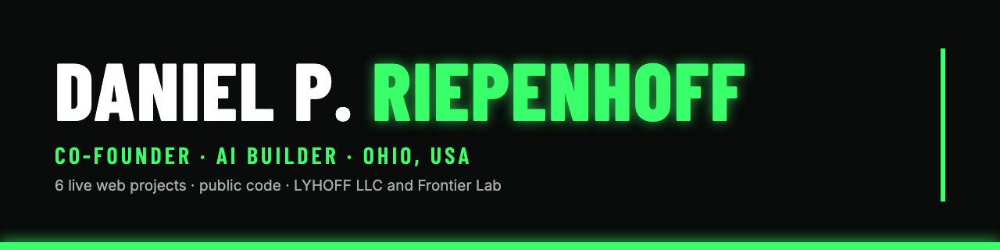
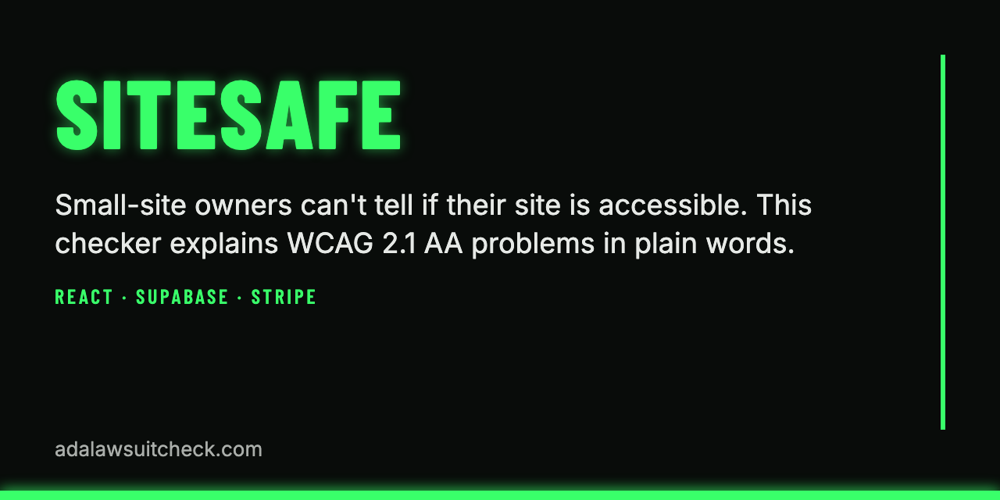
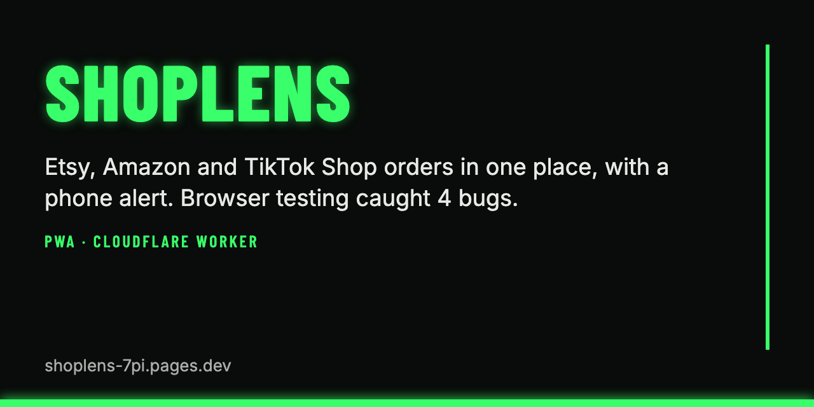
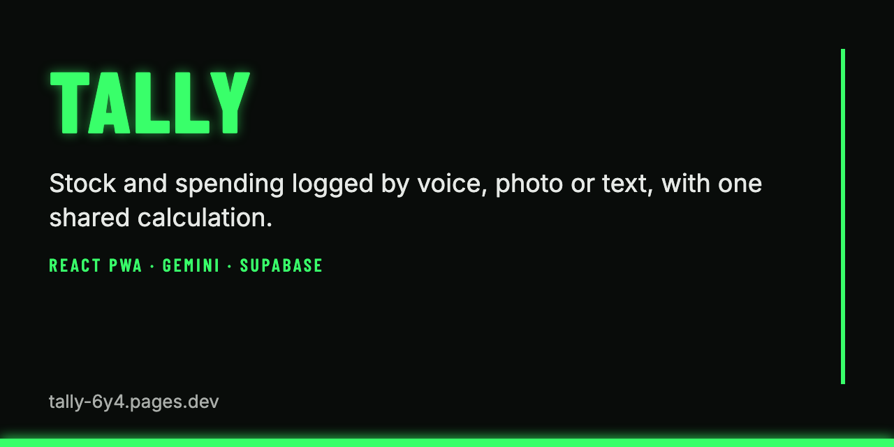
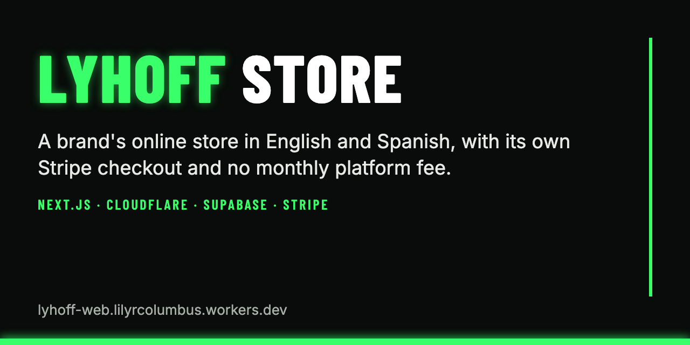
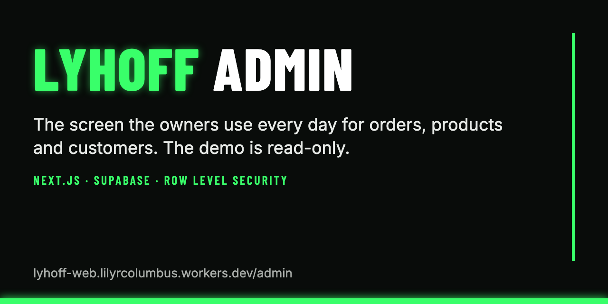
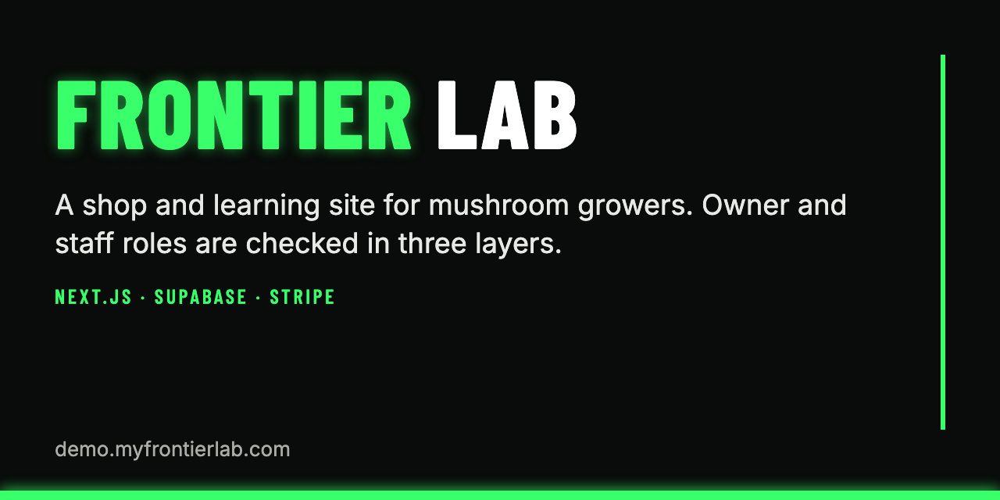

# Daniel P. Riepenhoff

**Co-founder of LYHOFF LLC and Frontier Lab · AI builder · Ohio, USA**

I co-own two small online brands and run their sales side. 6 web projects are live, each with public code.

## What we shipped

Click a card to open the live project.

<table>
<tr>
<td width="50%"></td>
<td width="50%"></td>
</tr>
<tr>
<td width="50%"></td>
<td width="50%"></td>
</tr>
<tr>
<td width="50%"></td>
<td width="50%"></td>
</tr>
</table>

| Project | The problem, and the proof | Live | Code |
|---|---|---|---|
| **SiteSafe** | Many small sites never get an accessibility check. SiteSafe (WCAG 2.1 AA) lists what to fix, in plain words. After end-to-end tests in a real browser, 3 gaps were fixed in production. | [adalawsuitcheck.com](https://adalawsuitcheck.com) | [ada-accessibility-checker](https://github.com/lilyrcolumbus-hash/ada-accessibility-checker) |
| **ShopLens** | Checking three selling sites for orders eats time. ShopLens shows every order on one page, with a push alert on the phone. Browser tests found 4 bugs, including the CORS error behind the broken disconnect buttons. | [shoplens-7pi.pages.dev](https://shoplens-7pi.pages.dev) | [shoplens](https://github.com/lilyrcolumbus-hash/shoplens) |
| **Tally** | Counting stock by hand is slow. Tally logs stock and spending by voice, photo or text. Three pages disagreed on stock; one shared calculation now feeds all three, checked with real numbers. | [tally-6y4.pages.dev](https://tally-6y4.pages.dev) | [tally](https://github.com/lilyrcolumbus-hash/tally) |
| **LYHOFF Store** | Where LYHOFF sells: English and Spanish pages, its own Stripe checkout and no monthly platform fee. One engine and one settings file per brand; a second brand already runs on it. | [lyhoff-web.lilyrcolumbus.workers.dev](https://lyhoff-web.lilyrcolumbus.workers.dev) | [lyhoff-web](https://github.com/lilyrcolumbus-hash/lyhoff-web) |
| **LYHOFF Admin demo** | The screen the owners use every day for orders, products, customers, discounts and pages. The demo is read-only: server and database refuse changes. A permissions hole in the database was found and closed. | [/admin](https://lyhoff-web.lilyrcolumbus.workers.dev/admin/) | [lyhoff-web](https://github.com/lilyrcolumbus-hash/lyhoff-web) |
| **Frontier Lab** | Shop and growing guide for mushroom growers, on the same engine as LYHOFF. Owner and staff roles are checked on screen, on the server and in the database. Public demo, no real payments. | [demo.myfrontierlab.com](https://demo.myfrontierlab.com) | [frontier-lab-shop](https://github.com/lilyrcolumbus-hash/frontier-lab-shop) |

## What goes into each one
- **The software:** built with Claude Code (Next.js, React, TypeScript, Supabase, Stripe, Cloudflare).
- **The brand and the sales:** logos, product photos and labels made with AI tools, listings on Amazon, Etsy and TikTok Shop.
- **The customers:** customer service every day, Stripe payments and Resend email.
- **An AI phone receptionist** for small businesses, set up with Twilio and other tools.

## Contact
codebake.SaaS@outlook.com · [lyhoff-web.lilyrcolumbus.workers.dev](https://lyhoff-web.lilyrcolumbus.workers.dev)
